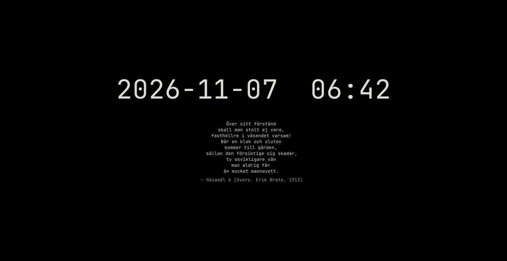

# NIRUSCREENSAVER

Small X11 idle screen: a clock with a themed CAVA spectrum or quotes, a photo slide show, or a dark screen with an optional C64 SID soundtrack.

**Status: beta** · Part of the [NIRUX](https://github.com/nirucon/nirux) suite · [MIT License](LICENSE)



## About

NIRUSCREENSAVER is the first step of the NIRUX idle ladder: after a while
without input, `niruidle` (from NIRUWM) shows it, and later NIRULOCK takes
over. It covers every screen with an opaque, calm composition in the active
NIRUX theme: the date, a large clock, how long you have been
away and, while music plays, a live CAVA spectrum with the playing track.
When it is quiet it shows quotes from Hávamál or the Stoics instead.

It is deliberately **not a lock**: any key or click dismisses it. Locking is
NIRULOCK's job.

## Features

- Five scenes: `clock` (default), `photos`, `dark`, `dark-sid` and
  `shuffle`, chosen in `screensaver.toml`, with `niruscreensaver --set scene
  NAME` or in the launcher (NIRUX Settings, then Screensaver).
- Five clock layouts: `cava` (default), `minimal`, `terminal`, `runic` and `corner`.
- `visual = "auto"`: the CAVA spectrum only while music plays, otherwise a
  quote that changes every minute.
- Artist and title of the playing MPRIS track under the spectrum
  (`show_media`).
- The dismissing key or click is swallowed, so it never reaches the window
  underneath; pointer motion does not dismiss unless you ask for it.
- Full opacity even under picom, a 300 ms fade-in (off with
  `reduced_motion`) and full coverage across output changes.
- Power-aware: with the display off or in silence, CAVA, `playerctl` and the
  spectrum repaint stop completely.
- Shares its CAVA, audio-detection, SID player, quote code and quote
  collections verbatim with NIRULOCK.

## Requirements

- Debian, Arch or Void Linux (glibc), x86_64, with X11.
- Optional: [CAVA](https://github.com/karlstav/cava) for the spectrum,
  `sidplayfp` for `dark-sid` (Debian and Void `sidplayfp`, Arch from the AUR),
  PipeWire (`pipewire-pulse`) or PulseAudio for music detection, `playerctl`
  for the track line, a runic font for the `runic` layout.
- Building from source: Rust 1.75 or newer, a C linker, fontconfig and a
  monospace font.

## Installation

### With NIRUX

NIRUSCREENSAVER is a core component. `nirux install` installs it and
`nirux update` keeps it current. See the
[NIRUX README](https://github.com/nirucon/nirux#installation).

### Standalone

```sh
git clone https://github.com/nirucon/niruscreensaver
cd niruscreensaver
./install.sh
```

The released binary goes to `~/.local/bin`.

| Option | Effect |
|---|---|
| `--build` | Build from this checkout instead of downloading |
| `--check` | Verify what is installed |
| `--prefix DIR` | Install under `DIR` instead of `~/.local` |
| `--uninstall` | Remove what the installer installed |

NIRUX-owned binaries are maintained with `nirux update`.

## Usage

```sh
niruscreensaver             # show it now, on every monitor
niruscreensaver --preview   # preview it on one monitor (focused, else primary)
niruscreensaver --preview dark   # preview a scene without choosing it
niruscreensaver --config    # print the effective settings
niruscreensaver --list      # the scenes, the chosen one and the shuffle list
niruscreensaver --settings  # the settings the launcher's Screensaver view shows
niruscreensaver --set scene photos         # change one setting, comments kept
niruscreensaver --shuffle toggle dark-sid  # add or remove a scene from shuffle
niruscreensaver --version
```

`--preview` covers only the monitor with the focused window (else the one
under the pointer, else the primary), so the other screens stay usable for
comparison. `niructl screensaver` shows it from the session on every monitor, and `niruidle` starts it
automatically after the idle timeout. With several monitors the layout is
drawn in the middle of each one, never across the seam between two, and the
saver stays above the bars and every other window. Any key or click dismisses it. In NIRUX,
`nirux manual screensaver` covers the idle ladder and every setting.

### Scenes

| Scene | Shows |
|---|---|
| `clock` | Default. The clock in one of the layouts below, with the spectrum or a quote |
| `photos` | The pictures in `photos_folder` (default `~/Pictures/Wallpapers/NIRU`, the NIRUX wallpapers), each for `photos_seconds`, drifting slowly and crossfading, with a small clock on a soft shade in the corner |
| `dark` | Black, with only the line "NIRUX - A MINIMAL X11 DESKTOP" gliding slowly across each screen and bouncing off its edges, so no pixel stays lit |
| `dark-sid` | As `dark`, with C64 SID tunes and the tune's title, composer and year under the line |
| `shuffle` | One of the scenes in `shuffle` (default `clock`, `photos` and `dark`), a new pick every time |

`photos` reads PNG and JPEG files two folder levels deep. When a picture
exists as `-4k` and `-8k` (the NIRUX wallpaper sets), the 4K one is used;
large JPEGs are decoded at a reduced size. Without any pictures the clock is
shown instead.

`dark-sid` plays exactly like NIRULOCK's pause music and shares its player:
`sidplayfp` plays the `.sid` files in the folder from NIRULOCK's
`[pause_music]` (default `~/Music/SID`, set in `~/.config/niruui/lock.toml`),
in natural order, and only if nothing else played during the first
2 seconds. Choosing `dark-sid` is the choice to play, so it also plays when
`niruidle` starts the saver; NIRULOCK's `enabled` and `on` do not apply. The
music stops when the display goes off, when a key or click ends the saver,
and when the lock takes over (`niruidle` ends the saver, and the player ends
with it). Without `sidplayfp` or tunes it stays silent.

With several monitors every scene draws on each one: the slide show scales
the picture for each screen, and the dark line glides on every screen on its
own path. `reduced_motion = true` stops the drift and crossfade and moves
the dark line once a minute instead.

### Clock layouts

| Layout | Composition |
|---|---|
| `cava` | Default. Large clock above the spectrum or a quote |
| `minimal` | Large centred clock |
| `terminal` | Left-aligned monospace screen with a `~$ idle` line |
| `runic` | The clock with a discreet rune row when a runic font is available |
| `corner` | Clock top-left, away time at the bottom |

The hostname is not shown unless you set `show_hostname = true`; it then
appears under the clock (`hostname:~$ idle` in `terminal`).

### Music or quotes

| `visual` | Shows |
|---|---|
| `auto` | Default. The CAVA spectrum only while music or radio plays, otherwise a quote |
| `cava` | The spectrum alone (CAVA runs whenever the display is on) |
| `quotes` | Quotes alone; CAVA never starts |
| `none` | Nothing; `visualizer = false` without `visual` also means `none` |

The quotes are plain text files in `~/.config/niru/quotes/`, shared with
NIRULOCK; see [docs/QUOTES.md](docs/QUOTES.md) for the format, how to add your
own and the sources of the built-in collections. How the spectrum, music
detection and power saving work is described in
[docs/BEHAVIOUR.md](docs/BEHAVIOUR.md).

## Configuration

Settings live in `~/.config/niruui/screensaver.toml` (XDG respected); see
[config.example.toml](config.example.toml). Colours follow the theme selected
in `~/.config/niruwm/config.toml`; `[palette]` overrides affect content only.

```toml
scene = "clock"                 # clock, photos, dark, dark-sid, shuffle
shuffle = ["clock", "photos", "dark"]
photos_folder = "~/Pictures/Wallpapers/NIRU"
photos_seconds = 20             # 5 to 3600
layout = "cava"                 # cava, minimal, terminal, runic, corner
visualizer = true
visual = "auto"                 # auto, cava, quotes, none
quotes = ["*"]                  # collections by name; * and ? patterns
show_media = true               # artist and title while music plays
font_size = 22.0
clock_size = 88.0
show_away_after_seconds = 60
dismiss_on_motion = false       # true: dismiss after 24 px of pointer motion
reduced_motion = false          # true: no fades
show_hostname = false           # true: show the machine name under the clock
```

**Timing** (when the screensaver appears, when the lock follows, when the
display sleeps) belongs to `niruidle` and is set in the shared `[idle]`
section of `~/.config/niruwm/config.toml`, or with
`niructl timing set KEY MINUTES`. The older `idle_minutes`,
`lock_after_minutes` and `dpms_off_minutes` keys in `screensaver.toml` are
only used when the shared file sets no `[idle]` values.

## Files and paths

| Path | Purpose |
|---|---|
| `~/.config/niruui/screensaver.toml` | Screensaver settings |
| `~/.config/niru/quotes/*.txt` | Quote collections (shared with NIRULOCK) |
| `~/.config/niruwm/config.toml` | Theme and the `[idle]` timing |
| `~/.local/bin/niruscreensaver` | Program |

## Troubleshooting

- **It never appears.** Check `niructl timing show` and that `niruidle` runs;
  idle inhibition (`Super+Shift+C`) also stops it.
- **The desktop shows through.** Make sure the compositor honours
  `_NET_WM_WINDOW_OPACITY`; the window class is `NIRUSCREENSAVER`.
- **No spectrum.** CAVA is not installed, `visual` is `quotes` or `none`, or
  (with `auto`) nothing is playing loud enough.
- **No music with `dark-sid`.** `sidplayfp` must be installed and the folder
  (NIRULOCK's `[pause_music] folder`, default `~/Music/SID`) must hold `.sid`
  files; other audio playing as the saver starts keeps it silent.
- **`photos` shows the clock.** `photos_folder` has no PNG or JPEG pictures;
  the saver says so on standard error.
- **The saver exits at once.** The keyboard or pointer grab failed (another
  program holds it); it exits non-zero rather than pretend.
- **Display power debugging.** `NIRUSCREENSAVER_TRACE=1` logs how the display
  power state is followed.

## Uninstall

With NIRUX, use `nirux uninstall`. A standalone install is removed with:

```sh
./install.sh --uninstall
```

## Building from source

```sh
cargo build --release --locked
cargo fmt --check
cargo clippy --all-targets -- -D warnings
cargo test
sh tests/resource-check.sh target/release/niruscreensaver   # Xvfb, xdotool, xev
sh tests/installer.sh
sh tests/twin-drift.sh                                      # needs network
```

`tests/twin-drift.sh` checks that the code (including the SID player used by
`dark-sid`) and quote files shared with
NIRULOCK match the tag in `tests/nirulock-tag`.
`NIRU_CAVA_TRACE=/path/to/file` appends one line per spectrum frame (the
milliseconds since start, `L`ive, `S`ilent or display `O`ff, the sequence
number of the CAVA frame shown, how many milliseconds ago it arrived, and the
48 bar heights) for measuring motion and frame pacing: a repeated or jumping
sequence number is a repeated or skipped frame. It records nothing else.

## Status, disclaimer and how it's made

**Status: beta.** NIRUSCREENSAVER runs on all my machines; I keep tuning the
spectrum's smoothness and power use.

NIRUX and every niru* project are made by me, Nicklas Rudolfsson
([@nirucon](https://github.com/nirucon)), for me. They are tailored to my own
needs, preferences and workflows, on my own machines. If they fit yours too,
that's a nice bonus.

- **Free and open source.** Anyone is free to use, study, change and share
  it under the [MIT License](LICENSE).
- **No guarantees.** There is no warranty of any kind. Use it at your own
  risk, read what you install and keep backups of anything that matters.
- **How it's made.** Some of these projects I built from scratch by hand. In
  more recent releases I have used Claude, Anthropic's AI, to do much of the
  heavy lifting under my direction: I decide what to build and how it should
  behave, and I test it on my own machines. It saves me a lot of time, and
  the result is quite OK.
- **Alpha, beta, dev, and maybe forever.** Most things here are alpha, beta
  or dev, and may stay that way. Maybe one day there will be a real stable
  release, but given how fast development moves, and how I am as a person,
  maybe never :)

| Label | Meaning |
|---|---|
| dev | Under active construction; may not build, install or work yet. |
| alpha | Works on my machines, but incomplete or rough; expect breaking changes. |
| beta | In daily use on my machines and mostly complete; rough edges remain. |

## License

MIT License, see [LICENSE](LICENSE). Copyright (c) 2026 Nicklas Rudolfsson.
