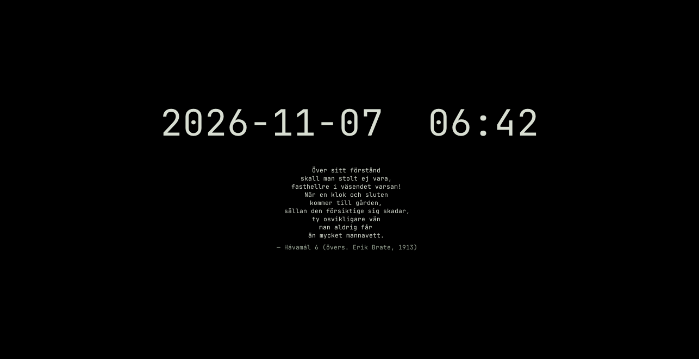

# NIRUSCREENSAVER

Small X11 idle screen with date, clock, away time and a themed CAVA spectrum or quotes.

**Status: beta** · Part of the [NIRUX](https://github.com/nirucon/nirux) suite · [MIT License](LICENSE)



## About

NIRUSCREENSAVER is the first step of the NIRUX idle ladder: after a while
without input, `niruidle` (from NIRUWM) shows it, and later NIRULOCK takes
over. It covers every screen with an opaque, calm composition in the active
NIRUX theme: the date, a large clock, the hostname, how long you have been
away and, while music plays, a live CAVA spectrum with the playing track.
When it is quiet it shows quotes from Hávamál or the Stoics instead.

It is deliberately **not a lock**: any key or click dismisses it. Locking is
NIRULOCK's job.

## Features

- Five layouts: `cava` (default), `minimal`, `terminal`, `runic` and `corner`.
- `visual = "auto"`: the CAVA spectrum only while music plays, otherwise a
  quote that changes every minute.
- "Artist – Title" of the playing MPRIS track under the spectrum
  (`show_media`).
- The dismissing key or click is swallowed, so it never reaches the window
  underneath; pointer motion does not dismiss unless you ask for it.
- Full opacity even under picom, a 300 ms fade-in (off with
  `reduced_motion`) and full coverage across output changes.
- Power-aware: with the display off or in silence, CAVA, `playerctl` and the
  30 fps repaint stop completely.
- Shares its CAVA, audio-detection, quote code and quote collections verbatim
  with NIRULOCK.

## Requirements

- Debian, Arch or Void Linux (glibc), x86_64, with X11.
- Optional: [CAVA](https://github.com/karlstav/cava) for the spectrum,
  PipeWire (`pipewire-pulse`) or PulseAudio for music detection, `playerctl`
  for the track line, a runic font for the `runic` layout.
- Building from source: Rust 1.75 or newer, a C linker, fontconfig and a
  monospace font.

## Installation

### With NIRUX

NIRUSCREENSAVER is a core component. `nirux install` installs it and
`nirux update` keeps it current. See the
[NIRUX README](https://github.com/nirucon/nirux#installation).

### Standalone

```sh
git clone https://github.com/nirucon/niruscreensaver
cd niruscreensaver
./install.sh
```

The released binary goes to `~/.local/bin`.

| Option | Effect |
|---|---|
| `--build` | Build from this checkout instead of downloading |
| `--check` | Verify what is installed |
| `--prefix DIR` | Install under `DIR` instead of `~/.local` |
| `--uninstall` | Remove what the installer installed |

NIRUX-owned binaries are maintained with `nirux update`.

## Usage

```sh
niruscreensaver             # show it now (same as --preview)
niruscreensaver --config    # print the effective settings
niruscreensaver --version
```

`niructl screensaver` shows it from the session, and `niruidle` starts it
automatically after the idle timeout. Any key or click dismisses it.

### Layouts

| Layout | Composition |
|---|---|
| `cava` | Default. Large clock and hostname above the spectrum or a quote |
| `minimal` | Large centred clock and hostname |
| `terminal` | Left-aligned monospace screen with a `hostname:~$ idle` line |
| `runic` | The clock with a discreet rune row when a runic font is available |
| `corner` | Clock top-left, hostname and away time at the bottom |

### Music or quotes

| `visual` | Shows |
|---|---|
| `auto` | Default. The CAVA spectrum only while music or radio plays, otherwise a quote |
| `cava` | The spectrum alone (CAVA runs whenever the display is on) |
| `quotes` | Quotes alone; CAVA never starts |
| `none` | Nothing; `visualizer = false` without `visual` also means `none` |

The quotes are plain text files in `~/.config/niru/quotes/`, shared with
NIRULOCK; see [docs/QUOTES.md](docs/QUOTES.md) for the format, how to add your
own and the sources of the built-in collections. How the spectrum, music
detection and power saving work is described in
[docs/BEHAVIOUR.md](docs/BEHAVIOUR.md).

## Configuration

Settings live in `~/.config/niruui/screensaver.toml` (XDG respected); see
[config.example.toml](config.example.toml). Colours follow the theme selected
in `~/.config/niruwm/config.toml`; `[palette]` overrides affect content only.

```toml
layout = "cava"                 # cava, minimal, terminal, runic, corner
visualizer = true
visual = "auto"                 # auto, cava, quotes, none
quotes = ["*"]                  # collections by name; * and ? patterns
show_media = true               # "Artist – Title" while music plays
font_size = 22.0
clock_size = 88.0
show_away_after_seconds = 60
dismiss_on_motion = false       # true: dismiss after 24 px of pointer motion
reduced_motion = false          # true: no fades
```

**Timing** (when the screensaver appears, when the lock follows, when the
display sleeps) belongs to `niruidle` and is set in the shared `[idle]`
section of `~/.config/niruwm/config.toml`, or with
`niructl timing set KEY MINUTES`. The older `idle_minutes`,
`lock_after_minutes` and `dpms_off_minutes` keys in `screensaver.toml` are
only used when the shared file sets no `[idle]` values.

## Files and paths

| Path | Purpose |
|---|---|
| `~/.config/niruui/screensaver.toml` | Screensaver settings |
| `~/.config/niru/quotes/*.txt` | Quote collections (shared with NIRULOCK) |
| `~/.config/niruwm/config.toml` | Theme and the `[idle]` timing |
| `~/.local/bin/niruscreensaver` | Program |

## Troubleshooting

- **It never appears.** Check `niructl timing show` and that `niruidle` runs;
  idle inhibition (`Super+Shift+C`) also stops it.
- **The desktop shows through.** Make sure the compositor honours
  `_NET_WM_WINDOW_OPACITY`; the window class is `NIRUSCREENSAVER`.
- **No spectrum.** CAVA is not installed, `visual` is `quotes` or `none`, or
  (with `auto`) nothing is playing loud enough.
- **The saver exits at once.** The keyboard or pointer grab failed (another
  program holds it); it exits non-zero rather than pretend.
- **Display power debugging.** `NIRUSCREENSAVER_TRACE=1` logs how the display
  power state is followed.

## Uninstall

With NIRUX, use `nirux uninstall`. A standalone install is removed with:

```sh
./install.sh --uninstall
```

## Building from source

```sh
cargo build --release --locked
cargo fmt --check
cargo clippy --all-targets -- -D warnings
cargo test
sh tests/resource-check.sh target/release/niruscreensaver   # Xvfb, xdotool, xev
sh tests/installer.sh
sh tests/twin-drift.sh                                      # needs network
```

`tests/twin-drift.sh` checks that the code and quote files shared with
NIRULOCK match the tag in `tests/nirulock-tag`.
`NIRU_CAVA_TRACE=/path/to/file` appends one line per spectrum frame (the
milliseconds since start, `L`ive, `S`ilent or display `O`ff, and the 48 bar
heights) for measuring motion and frame pacing; it records nothing else.

## Status, disclaimer and how it's made

**Status: beta.** NIRUSCREENSAVER runs on all my machines; I keep tuning the
spectrum's smoothness and power use.

NIRUX and every niru* project are made by me, Nicklas Rudolfsson
([@nirucon](https://github.com/nirucon)), for me. They are tailored to my own
needs, preferences and workflows, on my own machines. If they fit yours too,
that's a nice bonus.

- **Free and open source.** Anyone is free to use, study, change and share
  it under the [MIT License](LICENSE).
- **No guarantees.** There is no warranty of any kind. Use it at your own
  risk, read what you install and keep backups of anything that matters.
- **How it's made.** Some of these projects I built from scratch by hand. In
  more recent releases I have used Claude, Anthropic's AI, to do much of the
  heavy lifting under my direction: I decide what to build and how it should
  behave, and I test it on my own machines. It saves me a lot of time, and
  the result is quite OK.
- **Alpha, beta, dev, and maybe forever.** Most things here are alpha, beta
  or dev, and may stay that way. Maybe one day there will be a real stable
  release, but given how fast development moves, and how I am as a person,
  maybe never :)

| Label | Meaning |
|---|---|
| dev | Under active construction; may not build, install or work yet. |
| alpha | Works on my machines, but incomplete or rough; expect breaking changes. |
| beta | In daily use on my machines and mostly complete; rough edges remain. |

## License

MIT License, see [LICENSE](LICENSE). Copyright (c) 2026 Nicklas Rudolfsson.
